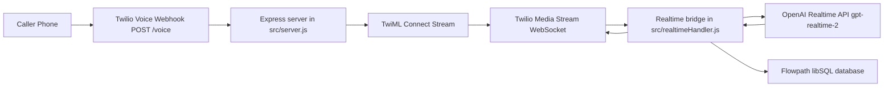

# Voice AI System

A Node.js voice assistant backend that connects live Twilio phone calls to the OpenAI Realtime API, runs a persona-driven assistant (Victoria), captures confirmed caller messages as Flowpath tasks, and can act as a voice interface for Tom's private Flowpath database.

## System Purpose

This system is built for three primary call flows:
- External callers can ask about Tom's background, work, and technical skills, then leave a structured message.
- Tom can call his own number to leave himself a quick voice note.
- Tom can ask Victoria about Flowpath tasks, projects, situations, check-ins, plans, and create/update selected Flowpath records by voice.

When an external caller confirms a message, Victoria calls a narrow legacy-named tool (`create_taskdeck_caller_intake_task`) that creates a new open Flowpath task from that caller's own message.

When Tom is the caller, Victoria can also call scoped Flowpath tools backed by the same libSQL database used by the Flowpath Next.js app. External callers are not allowed to read, search, update, or attach to private Flowpath data.

## Languages and Core Technologies

### Languages
- JavaScript (Node.js, ES modules)
- XML (TwiML generated at runtime for Twilio)

### Runtime and Server
- Node.js 18+
- Express (`/voice` webhook and `/health`)
- Native `http` server (hosts both HTTP endpoints and WS server)

### Realtime and Telephony
- `ws` WebSocket server for Twilio Media Streams
- Twilio Programmable Voice (`<Connect><Stream>`) for call audio ingress

### AI and Speech
- OpenAI Realtime API (`gpt-realtime-2`)
- Realtime server VAD (`server_vad`) for turn detection and interruption behavior
- OpenAI transcription model (`gpt-4o-transcribe`) for input audio transcription

### Configuration and Developer Tooling
- `dotenv` for environment variable loading
- `nodemon` for local autoreload during development

## Current vs Dormant Components

### Actively used in runtime path
- `src/server.js`
- `src/realtimeHandler.js`
- `ws`, `express`, `dotenv`
- `@libsql/client` for shared Flowpath database access

### Present but currently dormant or unused
- `src/firebase.js` and `firebase-admin` dependency (not in active call path)
- `src/twilioWebhook.js` helper and `twilio` package (not wired in `src/server.js`)
- `@openai/agents` and `@openai/agents-extensions` packages (installed, not referenced by active code)

## Architecture Overview



## End-to-End Call Flow

1. Twilio sends `POST /voice` to the app.
2. `src/server.js` returns TwiML with `<Connect><Stream ...>` pointing to `/realtime`.
3. Twilio opens a WebSocket stream and sends media/control events.
4. `src/realtimeHandler.js` opens a second WebSocket to OpenAI Realtime.
5. Audio frames are forwarded from Twilio to OpenAI (`input_audio_buffer.append`).
6. OpenAI returns response audio deltas; bridge forwards them back to Twilio.
7. On user barge-in, the bridge sends Twilio `clear` and OpenAI `response.cancel`.
8. When Victoria confirms an external caller message, the model calls `create_taskdeck_caller_intake_task`.
9. When Tom asks about Flowpath, model calls scoped Flowpath read/write tools.
10. Bridge validates/normalizes payloads, performs scoped database operations, then returns tool output.
11. Assistant confirms success/failure to the caller and logs a concise call summary.

## Realtime Session Design

`connectToOpenAI()` initializes realtime with:
- Model: `gpt-realtime-2`
- Output audio modality with `audio/pcmu`
- Input transcription: `gpt-4o-transcribe`
- Turn detection: `server_vad`

`attachRealtimeServer()` manages:
- Twilio stream lifecycle (`start`, `media`, `mark`, `stop`, close/error)
- OpenAI lifecycle (`session.*`, `response.*`, function call deltas)
- Function-call assembly for Flowpath caller-intake and private self-call tools
- App-controlled barge-in debounce before clearing/cancelling assistant audio
- Usage accounting (`input/output/audio/cached token` aggregates)

## Tool Contract: `create_taskdeck_caller_intake_task`

The assistant uses this external-caller-safe function tool:
- `confirmedByCaller`: boolean
- `callerName`: nullable string
- `contactPhone`: nullable string
- `contactEmail`: nullable string
- `subject`: string
- `messageBody`: string
- `callbackRequested`: boolean
- `priority`: `low | normal | high`

Behavior notes:
- Missing contact phone falls back to caller ID when available.
- The tool only creates a new open Flowpath task.
- The tool does not read, search, update, or attach to private Flowpath records.
- Tool output includes `{ ok, channel: "taskdeck_task", taskId?, reason? }`.

## Flowpath Tool Contracts

Victoria can use these tools only for self-calls, determined by caller ID matching `TWILIO_OWNER_PHONE`:

- `get_taskdeck_briefing`: read profile/memory, life areas, active projects, tasks, situations, recent check-ins, daily plans, and Next Move plans.
- `get_taskdeck_record`: read one exact Flowpath record by id.
- `create_taskdeck_task`: create a task after Tom confirms the exact task, including optional situation and Next Move plan attachment.
- `update_taskdeck_task`: update a known task after Tom confirms the exact change, including status, friction, estimate, situation, and plan attachment fields.
- `create_taskdeck_checkin`: create a daily check-in after Tom confirms the captured check-in.
- `create_taskdeck_situation`: create a new active situation and initial intake session after Tom confirms it.
- `update_taskdeck_situation`: update an existing situation after Tom confirms the exact change.
- `create_taskdeck_project` / `update_taskdeck_project`: create or update projects after confirmation.
- `create_taskdeck_life_area` / `update_taskdeck_life_area`: create or update life areas after confirmation.
- `create_taskdeck_daily_plan`: create a manually confirmed daily plan without triggering Flowpath plan generation.
- `create_taskdeck_tasks_from_next_move_plan`: convert an existing Next Move plan's task candidates into attached tasks.
- `search_web`: owner-only quick web lookup via the OpenAI Responses API `web_search` tool. Search results are conversational context only until Tom separately confirms any Flowpath write.

External callers get only `create_taskdeck_caller_intake_task`, which inserts a standalone task from their confirmed message and returns only a minimal result.

Victoria does not receive arbitrary SQL access. The voice service is a client of Flowpath's existing database, not the owner of Flowpath's schema or migrations.

The runtime function names still use `taskdeck_*` for compatibility, but Victoria is instructed to treat and describe them as Flowpath tools.

## Directory Map

- `src/server.js`: Express endpoints, TwiML response, server bootstrap
- `src/realtimeHandler.js`: Twilio/OpenAI realtime bridge, prompt/instructions, Flowpath caller intake
- `src/taskdeckData.js`: scoped Flowpath database adapter for read/write voice tools
- `src/twilioWebhook.js`: Alternate Twilio webhook helper (currently not wired)
- `src/firebase.js`: Dormant Firebase admin initialization (not used in active flow)
- `.env.example`: runtime configuration template

## Environment Variables

### Required for core call + AI flow
- `OPENAI_API_KEY`
- `TWILIO_STREAM_URL`

### Required for Tom/self-caller private Flowpath access
- `TWILIO_OWNER_PHONE`

### Required for deployed Flowpath voice access
- `FLOWPATH_DATABASE_URL` (same libSQL/Turso database used by Flowpath)
- `FLOWPATH_DATABASE_AUTH_TOKEN` if the shared database requires auth
- `FLOWPATH_OWNER_LOCAL_USER_ID` (defaults to `1`; Victoria only reads/writes this Flowpath user)

For local development, the voice service auto-detects the sibling Flowpath database at `../flowpath/data/flowpath.db` when present. You can also set:

```bash
FLOWPATH_DATABASE_URL=file:/Users/thomasdevito/Projects/flowpath/data/flowpath.db
```

Legacy `TASKDECK_*` and `NEEDLE_*` database environment variables and local database paths are still accepted as fallbacks.

### Optional
- `OPENAI_REALTIME_ENDPOINT` (runtime forces model query param to `gpt-realtime-2`)
- `OPENAI_WEB_SEARCH_MODEL` (default `gpt-4.1-mini` for faster voice lookups)
- `OPENAI_WEB_SEARCH_CONTEXT_SIZE` (`low`, `medium`, or `high`; default `low`)
- `OPENAI_WEB_SEARCH_MAX_TOOL_CALLS` (default `1`; higher values allow deeper but slower searches)
- `OPENAI_WEB_SEARCH_MAX_OUTPUT_TOKENS` (default `220`)
- `OPENAI_WEB_SEARCH_REASONING_EFFORT` (`low`, `medium`, `high`, or `xhigh`; default `low` when using GPT-5/o-series search models)
- `OPENAI_WEB_SEARCH_TIMEOUT_MS` (default `12000`)
- `PHONE_RELAY_NUMBER`
- `PORT` (default `8080`)
- `VERBOSE_OPENAI_LOGS=true` for deeper event logs
- `APP_TIMEZONE` (default `America/New_York`)

### Dormant
- `FIREBASE_SERVICE_ACCOUNT_JSON` (not needed in current runtime path)

## Local Development

1. Install dependencies:
```bash
npm install
```

2. Copy environment template and fill values:
```bash
cp .env.example .env
```

3. Run locally:
```bash
npm run dev
```

4. Health check:
```bash
curl http://localhost:8080/health
```

5. Expose local server (example with ngrok) and configure Twilio Voice webhook to `POST https://<your-domain>/voice`.

## Operational Notes

- External caller messages are persisted as standalone open Flowpath tasks after caller confirmation.
- If Flowpath database access is unavailable, voice conversation still works but caller-intake task creation fails.
- Firebase can be reintroduced later through a storage adapter path without changing call transport architecture.

## Troubleshooting

- `TWILIO_STREAM_URL not configured`: set `TWILIO_STREAM_URL` in `.env`.
- OpenAI connection fails: verify `OPENAI_API_KEY` and network egress.
- Tom is not recognized as self-caller: verify `TWILIO_OWNER_PHONE` matches the caller ID format.
- Assistant talks but cannot create caller task: check Flowpath database env vars and logs for `create_taskdeck_caller_intake_task`.
