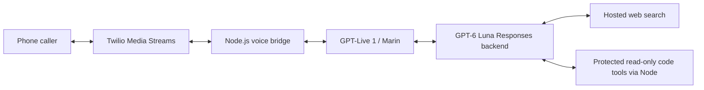

# Victoria Voice Assistant

Victoria answers phone calls through Twilio and GPT-Live. Public callers can talk
about Tom's professional and creative background. Every caller has public web
search and protected read-only inspection of this service's current source code.
There is no database integration, message saving, task management, persistent
conversation memory, calendar, email, SMS, or outbound action tool.

## Architecture



- Voice: `gpt-live-1`, voice `marin`, using the Live primary WebSocket.
- Backend: `gpt-6-luna` through managed Responses delegation, low reasoning effort,
  concise output, at most 800 output tokens per backend response.
- Audio: raw mono G.711 mu-law at 8 kHz (`audio/pcmu`) in both directions. Twilio
  bytes pass through without conversion.
- Transport: Express and `ws`. The existing `/realtime` phone-stream path is
  preserved; it now connects to `/v1/live/sessions`, with no model query string.
- Storage: `store: false`; no recordings, transcripts, caller messages, or call
  history are persisted by this application. Operational summaries omit phone
  numbers, grants, transcript text, and tool contents.

The voice and backend prompts are separate in `src/assistantConfig.js`. The voice
prompt defines Victoria's personality, greeting, interruption behavior, and when
to delegate. It includes a small public profile so simple questions about Tom can
be answered directly. Tom, Thomas, and Tom DeVito refer to Thomas DeVito on this
phone line unless the caller means someone else. The backend supplies detailed
background, a dated public portfolio snapshot, and tool rules. Portfolio descriptions
do not establish live availability or completed functionality.

Victoria generates her greeting live in Marin's voice; no prerecorded audio file
is used. The startup input asks her to begin immediately, and the bridge sends the
same greeting cue once through `session.commentary.append` after `session.started`,
without waiting for caller speech. Acknowledgment of that cue does not confirm
spoken audio; the opening still needs a phone listening check. Her voice prompt
asks for warm, gentle, slightly slower, unhurried speech with brief pauses. Pacing
is controlled through instructions, with no API speed parameter. Recognizing Tom's
number changes the greeting and pronouns only; it does not change tool access.

## Call flow and permissions

1. Twilio posts a signed form webhook to `/voice`.
2. The server verifies `X-Twilio-Signature` against the configured public origin.
3. The signed webhook issues an in-memory, single-use stream grant bound to the
   call ID. Grants expire after 60 seconds; at most 1,024 are retained.
4. A valid Twilio WebSocket upgrade starts the OpenAI transport connection while
   the bridge waits for the stream's single-use grant and call ID. This overlaps
   transport setup with the phone start event. Unsigned upgrades never connect to
   OpenAI; at most eight connections may wait for a valid start, with a 15-second
   startup deadline. Caller-number or role custom parameters are ignored.
5. Only after a valid stream grant and an open provider connection does the server
   send `session.start`, with the greeting in the initial input. It waits for
   `session.started` before sending the one-time greeting cue and forwarding phone
   audio, including silence. Setup audio is discarded,
   never queued or replayed in a burst. There is no PIN prompt or DTMF verification.
   `/voice/owner` and `/voice/public` remain signed compatibility routes with the
   same behavior as `/voice`; `Digits` does not authenticate a caller.
6. Audio flows in both directions continuously. Live owns interruptions and
   turn-taking; the bridge does not cancel responses or discard output whenever
   a noise is detected. Twilio playback marks track audio actually played.
7. Hosted search runs inside the Responses backend. Custom code functions are
   collected by response and call ID, validated in Node, deduplicated,
   executed sequentially, and returned with `response.item.create` followed by
   `response.create` only after all known pending calls have their results.
8. A caller stop, failure, or duration/budget limit stops new work, aborts pending
   custom tools, and requests `session.close`. The connection stays open for
   final `session.closed` usage, with a 15-second finalization deadline. There is
   no automatic reconnect or paid retry. Returning from the stream ends the call.

Every caller receives the same tools:

| Tool | Purpose |
| --- | --- |
| `web_search` | OpenAI-hosted public research; speak source names and retain citations in backend results. |
| `get_codebase_overview` | List approved source files and available Git metadata. |
| `search_codebase` | Search approved source text. |
| `read_code_snippet` | Read a line-numbered snippet, capped at 120 lines. |

Code inspection uses the running filesystem. A newly deployed version therefore
exposes its own current source without retraining Victoria. Inspection is limited
to approved source/test/docs files and selected root metadata. Hidden files,
credentials, configuration artifacts, lockfiles, large files, and path escapes
are excluded; obvious embedded credentials are redacted. This is a defensive
filter, not a guarantee that arbitrary source is safe to publish. The tools cannot
edit files, execute shell commands, inspect other repositories, or grant access.

## Runtime configuration

Node.js 24 is used for development. Configure values yourself in the existing
local environment or your deployment's secret manager. Never commit credentials.

| Variable | Use |
| --- | --- |
| `OPENAI_API_KEY` | Required server-side OpenAI access. Never sent to the caller. |
| `TWILIO_AUTH_TOKEN` | Required to verify Twilio HTTP and WebSocket signatures. |
| `TWILIO_STREAM_URL` | Required public `wss://` stream URL, including its existing path. No query string or credentials. Its origin must match the public voice-webhook origin. |
| `TWILIO_OWNER_PHONE` | Optional number recognition for Tom's greeting and pronouns; E.164 recommended. Does not control tool access. |
| `PORT` | Optional HTTP listening port; defaults to `8080`. |

Missing required configuration makes `/voice` return 503. `/health` checks the
HTTP process only; it does not verify OpenAI access or call quality. The health
response reports model names, the deployment revision when available,
`toolsAvailable: true`, `ownerRecognitionConfigured` for optional number recognition,
and missing required configuration names. It never returns credential values;
configuration presence does not verify that credentials are valid.

`TWILIO_OWNER_PIN` is obsolete and unused. An existing deployment value can remain
in place; these changes do not read or modify it.

The configured public origin is used for signature checks; caller-controlled
Host/forwarding headers are not trusted. If the webhook and stream use different
public origins or a proxy rewrites paths, adjust routing deliberately before
release. Stream grants are process-local: the webhook and its stream must reach
the same server instance. Multiple replicas need sticky routing or a shared grant
store before use.

No production configuration, credentials, webhook settings, or deployment are
changed automatically by this repository migration.

## Local development and verification

```bash
npm ci
npm test
npm run dev
```

`npm run dev` starts the actual phone assistant; it is not an offline simulation.
An authenticated incoming call can incur OpenAI and Twilio charges. Do not trigger
calls as a test without explicit host/app and call-budget approval.

`npm test` uses fake credentials, mocked provider sockets, synthetic source
fixtures, and loopback-only HTTP/WebSocket tests. It does not load `.env`, contact
OpenAI/Twilio, or start emulators. Tests cover Live startup/readiness, full-duplex
media and playback marks, signed ingress, grant validation, equal tool access,
tool-call correlation and duplicate suppression, failure/timeout shutdown, and cumulative
usage accounting. No separate build or lint scripts are configured.

Default runtime limits are in `src/realtimeHandler.js`: 15-second startup and
finalization deadlines, 10-second custom-tool and 30-second backend deadlines,
eight pending startup connections, 30-minute calls, 24 backend responses and custom
calls per call, and two seconds of unacknowledged playback. Exceeding a limit ends
the session rather than silently dropping speech or retrying. These are application
guardrails, not an exact monetary spend cap; hosted searches and backend tokens are
billed separately.

Call summaries include monotonic elapsed timings, measured from acceptance of the
phone WebSocket: `providerConnectMs`, `phoneStartMs`, `providerOpenMs`,
`sessionStartSentMs`, `sessionReadyMs`, `firstInputAudioMs`, `firstOutputAudioMs`,
and `firstPlaybackAckMs`. Session readiness and the first output/playback events
also produce content-free logs. The summary's `isOwner` field means number
recognition only. A first audio packet can contain silence, and a playback mark
does not prove a human heard the greeting.

Earlier caller testing confirmed web search and code inspection. The latest startup
and pacing changes have not been verified in a real phone call; faster audible
startup and slower speech remain to be checked by listening. Offline tests establish
bridge behavior, not provider availability or listening quality.

## Files

- `src/server.js`: signed HTTP routes, TwiML, executable entry point.
- `src/callSecurity.js`: signature checks, number recognition, ephemeral stream grants.
- `src/realtimeHandler.js`: Live/Twilio bridge, startup timing, and session/tool lifecycle.
- `src/assistantConfig.js`: voice/backend prompts, session configuration, tool contracts.
- `src/codebaseData.js`: constrained source inspection.
- `test/`: offline unit and mocked/loopback integration tests.

Historical restaurant/Firebase modules remain outside the active voice path and
are not imported by the server or its tools.

## Official protocol references

- [Live primary WebSocket](https://developers.openai.com/api/reference/resources/live/primary-websocket)
- [Responses delegation and tool continuation](https://developers.openai.com/api/docs/guides/live-delegation)
- [Session lifecycle and usage](https://developers.openai.com/api/docs/guides/live-conversations)
- [Live prompting](https://developers.openai.com/api/docs/guides/live-prompting)
- [Twilio request security](https://www.twilio.com/docs/usage/security)
