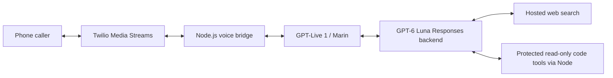

# Victoria Voice Assistant

Victoria answers phone calls through Twilio and GPT-Live. Public callers can talk
about Tom's professional and creative background. Verified owner calls also have
public web search and read-only inspection of this service's current source code.
There is no database integration, message saving, task management, persistent
conversation memory, calendar, email, SMS, or outbound action tool.

## Architecture



- Voice: `gpt-live-1`, voice `marin`, using the Live primary WebSocket.
- Backend: `gpt-6-luna` through managed Responses delegation, low reasoning effort,
  concise output, at most 800 output tokens per backend response.
- Audio: raw mono G.711 mu-law at 8 kHz (`audio/pcmu`) in both directions. Twilio
  bytes pass through without conversion.
- Transport: Express and `ws`. The existing `/realtime` phone-stream path is
  preserved; it now connects to `/v1/live/sessions`, with no model query string.
- Storage: `store: false`; no recordings, transcripts, caller messages, or call
  history are persisted by this application. Operational summaries omit phone
  numbers, PINs, grants, transcript text, and tool contents.

The voice and backend prompts are separate in `src/assistantConfig.js`. The voice
prompt defines Victoria's personality, greeting, interruption behavior, and when
to delegate. The backend prompt supplies background facts, permissions, and tool
rules. Current project status is not invented from an old project list.

## Call flow and permissions

1. Twilio posts a signed form webhook to `/voice`.
2. The server verifies `X-Twilio-Signature` against the configured public origin.
3. The signed webhook issues an in-memory, single-use stream grant bound to the
   call ID. Grants expire after 60 seconds; at most 1,024 are retained.
4. The WebSocket upgrade signature and the stream's grant/call ID are checked
   before any OpenAI connection starts. Custom caller-number or role parameters
   supplied by a stream are ignored.
5. The server sends `session.start` and waits for `session.started`. There can be
   a short quiet pause before Victoria's first greeting. Wait for her greeting
   before speaking or entering keypad digits; audio received before Live is ready
   is deliberately not forwarded.
6. When owner verification is configured and the caller number matches, Victoria
   asks for the owner PIN in her normal Marin voice during the Live session.
   Enter it on the keypad, then press pound; press star to continue without private
   tools. The bridge checks Twilio's DTMF events and never sends PIN digits to
   OpenAI or logs them. Until the server confirms verification, the session has no
   tools. A missing or incorrect PIN continues with public permissions, without a
   retry loop. Keypad entry has a 30-second deadline. Owner tools activate only
   after Live acknowledges the backend update; a missing acknowledgment ends the
   call after 10 seconds. Never say the PIN aloud; claiming to be Tom cannot grant access.
7. Audio flows in both directions continuously. Live owns interruptions and
   turn-taking; the bridge does not cancel responses or discard output whenever
   a noise is detected. Twilio playback marks track audio actually played.
8. Hosted search runs inside the Responses backend. Custom code functions are
   collected by response and call ID, authorized again in Node, deduplicated,
   executed sequentially, and returned with `response.item.create` followed by
   `response.create` only after all known pending calls have their results.
9. A caller stop, failure, or duration/budget limit stops new work, aborts pending
   custom tools, and requests `session.close`. The connection stays open for
   final `session.closed` usage, with a 15-second finalization deadline. There is
   no automatic reconnect or paid retry. Returning from the stream ends the call.

Public sessions receive **no tools**. Verified owner sessions receive:

| Tool | Purpose |
| --- | --- |
| `web_search` | OpenAI-hosted public research; speak source names and retain citations in backend results. |
| `get_codebase_overview` | List approved source files and available Git metadata. |
| `search_codebase` | Search approved source text. |
| `read_code_snippet` | Read a line-numbered snippet, capped at 120 lines. |

Code inspection uses the running filesystem. A newly deployed version therefore
exposes its own current source without retraining Victoria. Inspection is limited
to approved source/test/docs files and selected root metadata. Hidden files,
credentials, configuration artifacts, lockfiles, large files, and path escapes
are excluded; obvious embedded credentials are redacted. This is a defensive
filter, not a guarantee that arbitrary source is safe to publish. The tools cannot
edit files, execute shell commands, inspect other repositories, or grant access.

## Runtime configuration

Node.js 24 is used for development. Configure values yourself in the existing
local environment or your deployment's secret manager. Never commit credentials.

| Variable | Use |
| --- | --- |
| `OPENAI_API_KEY` | Required server-side OpenAI access. Never sent to the caller. |
| `TWILIO_AUTH_TOKEN` | Required to verify Twilio HTTP and WebSocket signatures. |
| `TWILIO_STREAM_URL` | Required public `wss://` stream URL, including its existing path. No query string or credentials. Its origin must match the public voice-webhook origin. |
| `TWILIO_OWNER_PHONE` | Optional owner number; E.164 recommended. Matching alone does not enable private tools. |
| `TWILIO_OWNER_PIN` | Optional owner verification PIN: 4–12 digits. Required with the matching owner number for owner tools. Enter it using the keypad after Victoria's Marin prompt. The bridge verifies DTMF during the Live session; digits are never forwarded to OpenAI or application logs. |
| `PORT` | Optional HTTP listening port; defaults to `8080`. |

Missing required configuration makes `/voice` return 503. `/health` checks the
HTTP process only; it does not verify OpenAI access or call quality. Without valid
owner verification configuration, calls continue with public permissions.
The health response also reports model names, the deployment revision when available,
and missing required/owner configuration names. It never returns credential values;
configuration presence does not verify that credentials are valid.

The configured public origin is used for signature checks; caller-controlled
Host/forwarding headers are not trusted. If the webhook and stream use different
public origins or a proxy rewrites paths, adjust routing deliberately before
release. Stream grants are process-local: the webhook and its stream must reach
the same server instance. Multiple replicas need sticky routing or a shared grant
store before use.

No production configuration, credentials, webhook settings, or deployment are
changed automatically by this repository migration.

## Local development and verification

```bash
npm ci
npm test
npm run dev
```

`npm run dev` starts the actual phone assistant; it is not an offline simulation.
An authenticated incoming call can incur OpenAI and Twilio charges. Do not trigger
calls as a test without explicit host/app and call-budget approval.

`npm test` uses fake credentials, mocked provider sockets, synthetic source
fixtures, and loopback-only HTTP/WebSocket tests. It does not load `.env`, contact
OpenAI/Twilio, or start emulators. Tests cover Live startup/readiness, full-duplex
media and playback marks, signed ingress, PIN/grant permissions, tool-call
correlation and duplicate suppression, failure/timeout shutdown, and cumulative
usage accounting. No separate build or lint scripts are configured.

Default runtime limits are in `src/realtimeHandler.js`: 15-second startup and
finalization deadlines, 10-second custom-tool and 30-second backend deadlines,
30-minute calls, 24 backend responses and custom calls per call, and two seconds
of unacknowledged playback. Exceeding a limit ends the session rather than
silently dropping speech or retrying. These are application guardrails, not an
exact monetary spend cap; hosted searches and backend tokens are billed separately.

A real phone call is still needed before release to check audible quality,
interruptions, greeting timing, search latency, and final call teardown. Offline
success establishes the bridge logic, not provider availability or listening
quality.

## Files

- `src/server.js`: signed HTTP routes, TwiML, executable entry point.
- `src/callSecurity.js`: signature checks, owner verification, ephemeral stream grants.
- `src/realtimeHandler.js`: Live/Twilio bridge, keypad owner verification, and session/tool lifecycle.
- `src/assistantConfig.js`: voice/backend prompts, session configuration, tool contracts.
- `src/codebaseData.js`: constrained source inspection.
- `test/`: offline unit and mocked/loopback integration tests.

Historical restaurant/Firebase modules remain outside the active voice path and
are not imported by the server or its tools.

## Official protocol references

- [Live primary WebSocket](https://developers.openai.com/api/reference/resources/live/primary-websocket)
- [Responses delegation and tool continuation](https://developers.openai.com/api/docs/guides/live-delegation)
- [Session lifecycle and usage](https://developers.openai.com/api/docs/guides/live-conversations)
- [Live prompting](https://developers.openai.com/api/docs/guides/live-prompting)
- [Twilio request security](https://www.twilio.com/docs/usage/security)
